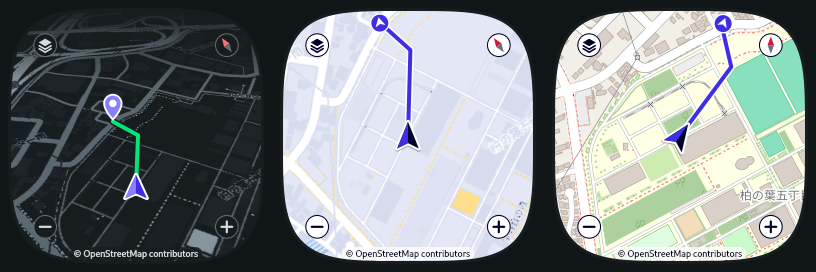

# autoware_minimap_overlay_rviz_plugin

An RViz overlay that shows a map around the vehicle, with the goal and the route to it.



## Purpose

The minimap shows where the vehicle is in the real world while you look at the 3D scene of RViz. It draws these items on map tiles of [OpenStreetMap](https://www.openstreetmap.org/):

- The vehicle, as an arrow that points to its heading
- The goal, as a pin
- The route, as a line from the vehicle to the goal

If the goal is outside the minimap, a marker at the edge of the minimap points to the goal.

## Controls on the minimap

You control the minimap with the mouse. The minimap does not pass these mouse actions to the RViz tools. A mouse button that you press outside the minimap stays with the RViz tool until you release it, also above the minimap.

| Control                             | Action                                                                           |
| ----------------------------------- | -------------------------------------------------------------------------------- |
| Layers button (top left)            | Changes the map style: Navigation Dark, Navigation Light, then OpenStreetMap     |
| Compass button (top right)          | Changes the view: 3D, Heading Up, then North Up. The red tip points to north.    |
| `-` and `+` buttons (bottom)        | Change the zoom level                                                            |
| Mouse wheel                         | Changes the zoom level                                                           |
| Drag with the left or middle button | Moves the map. The minimap then does not follow the vehicle.                     |
| Recenter button                     | Shows after you move the map. It moves the map back, to follow the vehicle again |

## Inputs / Outputs

### Input

| Name                      | Type                                             | Description                                               |
| ------------------------- | ------------------------------------------------ | --------------------------------------------------------- |
| `/api/vehicle/kinematics` | `autoware_adapi_v1_msgs::msg::VehicleKinematics` | The geographic position and the heading of the vehicle    |
| `/api/routing/route`      | `autoware_adapi_v1_msgs::msg::Route`             | The goal, and the lanelets of the route                   |
| `/api/routing/state`      | `autoware_adapi_v1_msgs::msg::RouteState`        | The goal and the route show when a route is set           |
| `/map/vector_map`         | `autoware_map_msgs::msg::LaneletMapBin`          | The centerline of each route lanelet gives the route line |
| `/map/map_projector_info` | `autoware_map_msgs::msg::MapProjectorInfo`       | Converts the goal and the route to latitude and longitude |

The plugin has no output topics. It downloads map tiles from the address in the `Tile URL` property. The default is `https://tile.openstreetmap.org`.

## Parameters

The display has these properties in the `Displays` panel of RViz.

| Name                | Type  | Default Value   | Description                                                             |
| ------------------- | ----- | --------------- | ----------------------------------------------------------------------- |
| `Width`             | int   | 256             | Width of the minimap in pixels (64 to 1024)                             |
| `Height`            | int   | 256             | Height of the minimap in pixels (64 to 1024)                            |
| `Horizontal Anchor` | enum  | Left            | Left, Center, or Right side of the RViz view                            |
| `Vertical Anchor`   | enum  | Bottom          | Top, Center, or Bottom side of the RViz view                            |
| `Horizontal Margin` | int   | 10              | Horizontal distance from the anchor in pixels                           |
| `Vertical Margin`   | int   | 10              | Vertical distance from the anchor in pixels                             |
| `Shape`             | enum  | Squircle        | Squircle (a square with smooth corners), Circle, or Rectangle           |
| `Alpha`             | float | 0.6             | Opacity of the minimap (0 to 1)                                         |
| `Zoom`              | int   | 17              | Zoom level of the map (3 to 19). One level more shows half the distance |
| `View`              | enum  | 3D              | 3D, Heading Up, or North Up                                             |
| `Map Style`         | enum  | Navigation Dark | Navigation Dark, Navigation Light, or OpenStreetMap                     |

The `Tile URL` property (string) holds the address of the map tiles, with the placeholders `{z}`, `{x}`, and `{y}`. Its default is `https://tile.openstreetmap.org/{z}/{x}/{y}.png`. Change it to use a tile server of your own. For the navigation styles, the tiles must have the colors of the standard OpenStreetMap style. The minimap always shows the text "© OpenStreetMap contributors", so use only tiles that come from OpenStreetMap data.

The views:

- `North Up` keeps north at the top. The vehicle arrow turns.
- `Heading Up` turns the map, so that the vehicle arrow points to the top.
- `3D` is `Heading Up` with a tilted map. It shows more of the road ahead of the vehicle.

The map styles:

- `OpenStreetMap` shows the map tiles as they are.
- `Navigation Dark` and `Navigation Light` show mainly the roads. The dark style has the charcoal of the Autoware RViz theme, and it shows the route in green, as the 3D view of RViz does. Its vehicle arrow and its goal pin are purple. The light style has the [Autoware brand colors](https://docs.autoware.org/main/home/media-kit/). The tile server has only one style. Thus the plugin finds the roads, the water, the buildings, and the text of each tile by their colors, and gives them new colors.

A larger minimap shows the same part of the map and the same design, with more pixels. From 362 pixels on, it uses the map tiles of the next zoom level, so that the map stays sharp. One view uses at most 8 x 8 tiles. A minimap that needs more, for example a long and narrow one, uses the tiles of a lower zoom level, and its map is less sharp.

The display also shows status lines in the `Displays` panel: `Vehicle`, `Map projector`, `Route`, and `Map tiles`. If the minimap does not show an item, read these lines first.

## Usage

1. Start `rviz2`.
2. In the `Displays` panel, click `Add`.
3. In the `By display type` tab, select `MinimapDisplay` below `autoware_minimap_overlay_rviz_plugin`.
4. Click `OK`.
5. If necessary, change the properties of the display.

An example of the display in an RViz configuration file:

```yaml
- Class: autoware_minimap_overlay_rviz_plugin/MinimapDisplay
  Name: MinimapDisplay
  Enabled: true
  Width: 256
  Height: 256
  Horizontal Anchor: Left
  Vertical Anchor: Bottom
  Horizontal Margin: 10
  Vertical Margin: 10
  Shape: Squircle
  Alpha: 0.6
  Zoom: 17
  View: 3D
  Map Style: Navigation Dark
  Tile URL: https://tile.openstreetmap.org/{z}/{x}/{y}.png
```

## Assumptions / Known Limits

- The plugin needs internet access to download the map tiles. It keeps the tiles in a disk cache in `~/.cache/autoware_minimap_overlay_rviz_plugin`. If a tile does not download, the plugin tries again later, with a delay that grows up to 60 seconds. If the server refuses a tile (an HTTP status from 400 to 499, but not 408 or 429), the plugin does not request this tile again while it stays in the view.
- The plugin follows the [tile usage policy of OpenStreetMap](https://operations.osmfoundation.org/policies/tiles/) in these points: it caches the tiles, it sends a User-Agent that names this repository, it shows "© OpenStreetMap contributors" on the map, and the `Tile URL` property can point to a different server. The policy does not permit heavy use. For heavy use, a tile server of your own is necessary.
- The requests for the tiles tell the tile server which part of the map you look at, and thus approximately where the vehicle is. If this is not acceptable, use a tile server of your own, or disable the display.
- A map with a `Local` projector has no geographic position. The minimap then shows a message and no map.
- The minimap does not draw the vehicle, the goal, and the route correctly across the 180 degree meridian.
- The map tiles are images. Thus the text of the map turns with the map in the `Heading Up` and `3D` views.
- The navigation styles find the items of the map by their colors. An area that has the color of a large road shows as a large road.
- The heading comes from the orientation in the map frame. The plugin does not correct the small angle between the north of the map frame and true north.
- The route line follows the centerline of each preferred lanelet of the route. At a lane change, the line jumps from one lane to the next.

## License

This package has the Apache License, Version 2.0. The icons in `icons` are original work of this package and have the same license.

The map data and the map tiles are © [OpenStreetMap contributors](https://www.openstreetmap.org/copyright). The data has the Open Database License.
