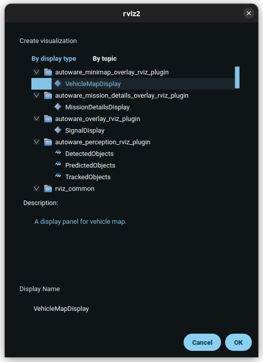
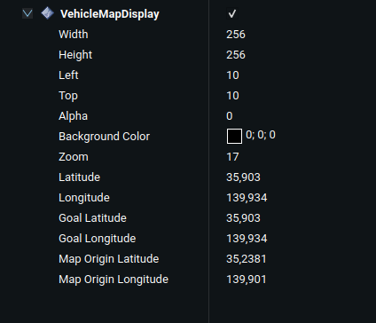

# autoware_minimap_overlay_rviz_plugin

Plugin for displaying a minimap overlay in RViz2 with vehicle position, goal pose, and route information.

## Purpose

This plugin provides a visual representation of the vehicle's position, the goal pose, and the planned route on a minimap overlay within RViz2. It is designed to enhance situational awareness by displaying relevant navigation information.

## Inputs / Outputs

### Input

| Name                      | Type                                             | Description                                              |
| ------------------------- | ------------------------------------------------ | -------------------------------------------------------- |
| `/api/vehicle/kinematics` | `autoware_adapi_v1_msgs::msg::VehicleKinematics` | The geographic pose of the vehicle                       |
| `/api/routing/route`      | `autoware_adapi_v1_msgs::msg::Route`             | The route, the goal pose is taken from it                |
| `/api/routing/state`      | `autoware_adapi_v1_msgs::msg::RouteState`        | The routing state, goal and path show when it's SET      |
| `/planning/trajectory`    | `autoware_planning_msgs::msg::Trajectory`        | The planned trajectory, drawn as the path                |
| `/map/map_projector_info` | `autoware_map_msgs::msg::MapProjectorInfo`       | Converts the goal and the path to latitude and longitude |

## Parameters

### Core Parameters

#### VehicleMapDisplay

| Name                | Type  | Default Value | Description                                                  |
| ------------------- | ----- | ------------- | ------------------------------------------------------------ |
| `Width`             | int   | 256           | Width of the overlay in pixels (1 to 500)                    |
| `Height`            | int   | 256           | Height of the overlay in pixels (1 to 500)                   |
| `Vertical Margin`   | int   | 10            | Vertical distance from the anchor in pixels                  |
| `Horizontal Margin` | int   | 10            | Horizontal distance from the anchor in pixels                |
| `Vertical Anchor`   | enum  | Bottom        | Top, Center, or Bottom of the RViz view                      |
| `Horizontal Anchor` | enum  | Left          | Left, Center, or Right of the RViz view                      |
| `Border Radius`     | int   | 128           | Corner radius of the overlay; half the height makes a circle |
| `Alpha`             | float | 1.0           | Opacity of the overlay                                       |
| `Tile Provider`     | enum  | OpenStreetMap | Source of the map tiles                                      |
| `Zoom`              | int   | 15            | Zoom level of the map (15 to 18)                             |
| `Latitude`          | float | (read-only)   | Latitude of the ego vehicle                                  |
| `Longitude`         | float | (read-only)   | Longitude of the ego vehicle                                 |
| `Goal Latitude`     | float | (read-only)   | Latitude of the goal pose                                    |
| `Goal Longitude`    | float | (read-only)   | Longitude of the goal pose                                   |

## Important Note

- The plugin needs internet access to download the map tiles. It keeps the downloaded tiles in a disk cache under `~/.cache/autoware_minimap_overlay_rviz_plugin`, and it shows "© OpenStreetMap contributors" on the map, as the [OpenStreetMap tile usage policy](https://operations.osmfoundation.org/policies/tiles/) asks.
- The goal pose and the path are converted to geographic coordinates with the map projector info of the loaded map. All projector types except `Local` are supported.
- The Latitude, Longitude, Goal Latitude and Goal Longitude properties show the received positions and cannot be edited.

## Assumptions / Known Limits

- The plugin assumes that the vehicle position and route topics are being published.
- A tile that fails to download is tried again later, with a growing delay up to 60 seconds.

## Usage

1. Start `rviz2` and click the `Add` button under the `Displays` panel.

   

2. Under the `By display type` tab, select `autoware_minimap_overlay_rviz_plugin/VehicleMapDisplay` and press OK.

3. Edit size, position or zoom parameters as needed.

   

## Example Configuration

Here is an example configuration for the VehicleMapDisplay:

```yaml
VehicleMapDisplay:
  Width: 256
  Height: 256
  Vertical Margin: 10
  Horizontal Margin: 10
  Vertical Anchor: Bottom
  Horizontal Anchor: Left
  Border Radius: 128
  Alpha: 1.0
  Tile Provider: OpenStreetMap
  Zoom: 16
```

## License

This package is licensed under the Apache License, Version 2.0.

The `goal.png` and `pos.png` icons are derived from [Material Symbols](https://fonts.google.com/icons), which are available under the [Apache License Version 2.0](https://www.apache.org/licenses/LICENSE-2.0).
